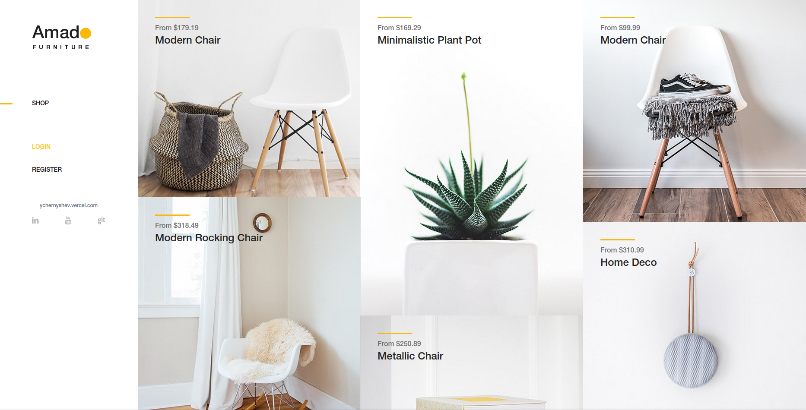
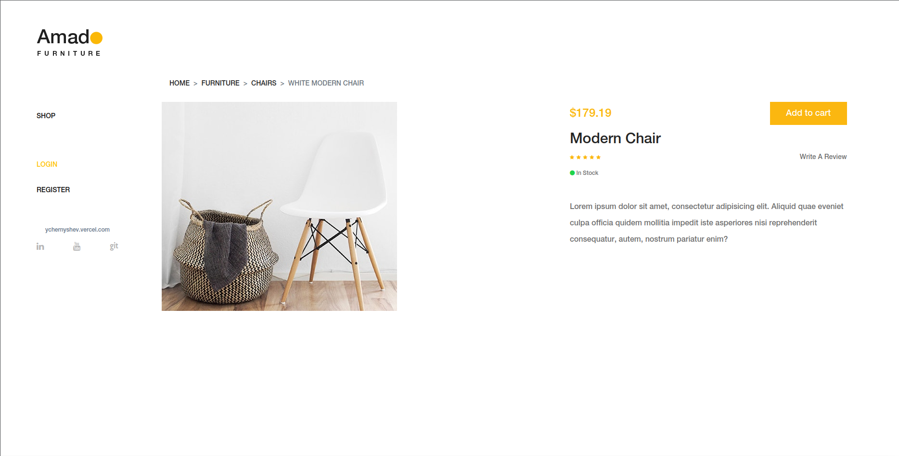
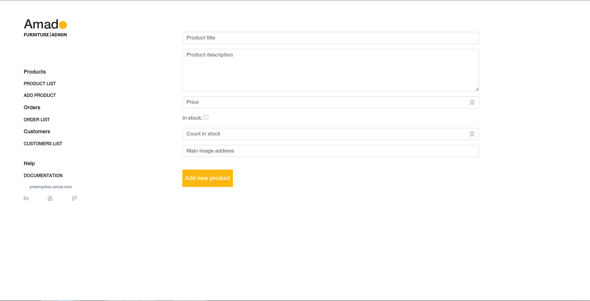

# The shop - The CRM
[](https://opensource.org/licenses/MIT)
[](https://www.python.org/)
[](https://www.djangoproject.com/)

## Description 
This project was created as part of my studies and as an example project for my portfolio in 2023. The process of creating the project has been recorded in videos and published on my YouTube channel. Links to the videos:
- [ESpace #1: Simple Login by Django Base User ](https://www.youtube.com/watch?v=3DttOh2KofU)
- [ESpase #2: Login Template Show info from Database Add info to the Database](https://www.youtube.com/watch?v=TvR7L9K2T_Q&pp=0gcJCSgLAYcqIYzv)
- [ESpace #3: Creating a Shop app, the home page, show products from the database, use shop template](https://www.youtube.com/watch?v=bSOAe3e79Lg)

## Project structure
The project consists of two parts:
- Shop (Clients side)
- Dashboard (Employments side)

## Project setup
### Add environment
```
python3 -m venv venv
```

### Activate environment
```
source venv/bin/activate 
```

### Install requirements
```
pip install -r requirements.txt
```

### Migrate models
```
python3 manage.py migrate
```
> Prepared the SQLite DB there is in the repository

### Run server
```
python3 manage.py runserver
```

### Page address
[http://localhost:8000](http://localhost:8000)

## 📜 License
This project is licensed under the MIT License - see the [LICENSE](LICENSE) file for details.

### Preview images
#### Shop




#### Dashboard

